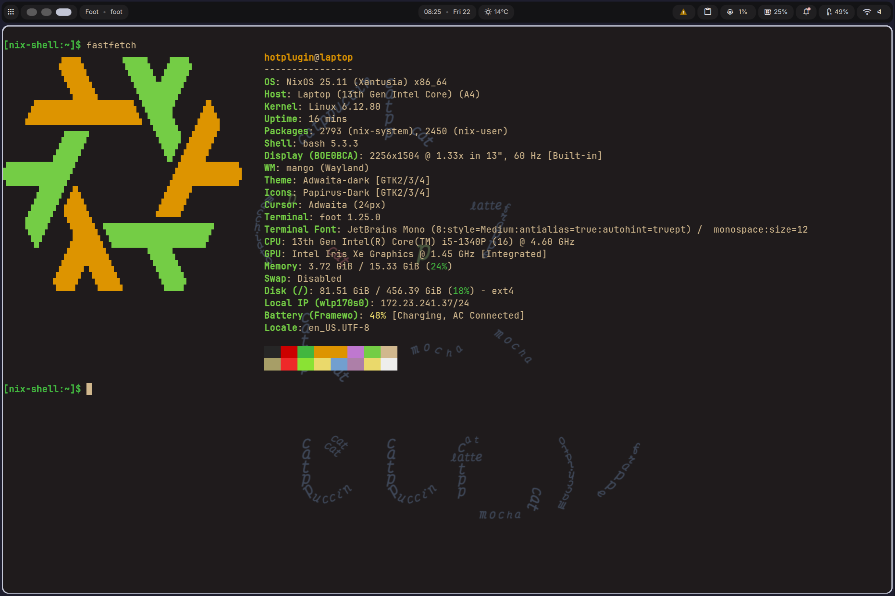
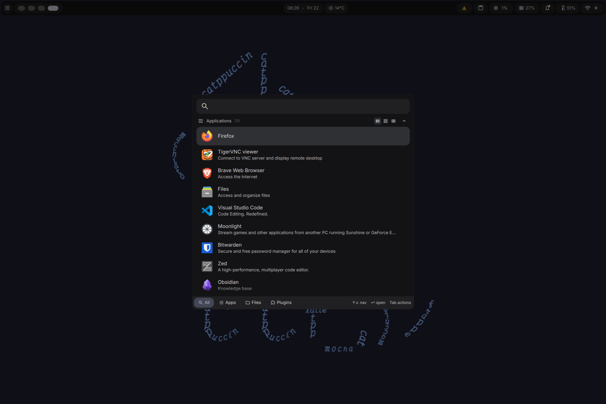
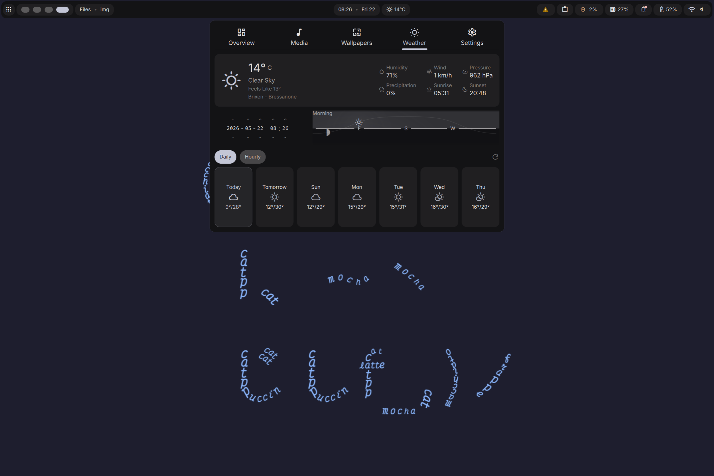
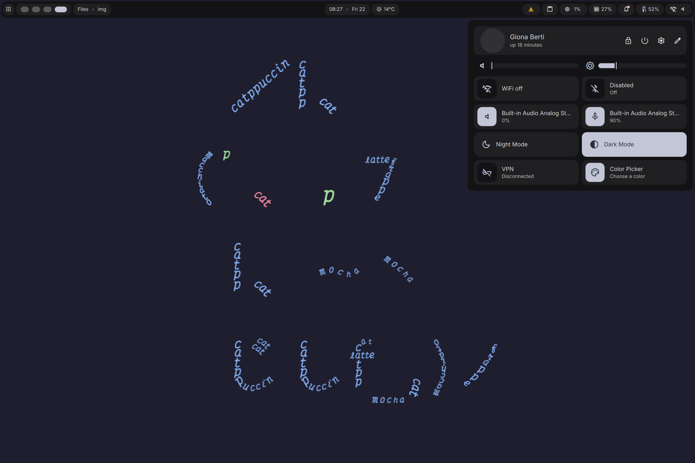

# NixOS Configuration

<p align="center">
  
  
  
  
</p>

This repository contains a multi-host NixOS and Home Manager configuration using a strict request/capability architecture.

The goal is not just to split files into folders. The goal is to make ownership obvious:

- each real setting has one owner
- shared behavior is requested through capabilities
- hosts stay small and declarative
- programs do not secretly configure unrelated system behavior
- profiles describe intent, not low-level implementation
- the active configuration stays clean and self-contained

The current hosts are:

| Host     | Class   | Desktop | Roles                                     |
| -------- | ------- | ------- | ----------------------------------------- |
| `pc`     | desktop | Mango   | workstation, desktop, gaming, development |
| `laptop` | laptop  | Mango   | workstation, desktop, development         |

The main user is:

| Username    | Full name   | Email           |
| ----------- | ----------- | --------------- |
| `hotplugin` | Giona Berti | mail@gberti.com |

---

## Repository Layout

```text
.
├── flake.nix
├── flake.lock
├── hosts/
│   ├── default.nix
│   ├── pc/
│   │   ├── default.nix
│   │   ├── hardware.nix
│   │   ├── hardware-configuration.nix
│   │   ├── storage.nix
│   │   └── home.nix
│   └── laptop/
│       ├── default.nix
│       ├── hardware.nix
│       ├── hardware-configuration.nix
│       ├── storage.nix
│       └── home.nix
├── users/
│   ├── default.nix
│   └── hotplugin.nix
├── modules/
│   ├── aggregate/
│   ├── core/
│   ├── profiles/
│   ├── capabilities/
│   ├── programs/
│   └── desktop/
```

---

## Architecture Overview

The configuration is built around five concepts:

```text
facts -> profiles -> requests -> capabilities -> implementation
```

The important rule is:

> Program modules do not configure shared platform behavior directly. They request capabilities. Capability modules provide that behavior once.

For example:

- Codex may request Git and shell support.
- Wine may request Windows fonts, runtime libraries, and locale support.
- The desktop profile may request XDG, theme, terminal, fonts, audio, and Polkit.
- The capability modules actually implement Git, Zsh, fonts, PipeWire, NetworkManager, and other shared systems.

---

## Flake

The root `flake.nix` defines inputs and builds the configured hosts.

Important inputs include:

- `nixpkgs`
- `nixpkgs-unstable`
- `nixos-hardware`
- `home-manager`
- `mango`
- `dms`
- `lanzaboote`
- `nixvim`

The flake builds:

```text
nixosConfigurations.pc
nixosConfigurations.laptop
```

It wires Home Manager into each NixOS system and imports:

```text
modules/aggregate/nixos.nix
modules/aggregate/home.nix
```

The aggregate files are the explicit module import graph.

---

## Hosts

Hosts are declared in:

```text
hosts/default.nix
```

Each host has:

- a system architecture
- typed host metadata
- a NixOS host module
- a Home Manager host module
- optional extra modules

Example host declaration in `hosts/default.nix`:

```nix
laptop = {
  system = "x86_64-linux";
  class = "laptop";
  roles = [ "workstation" "desktop" "gaming" "development" ];
  desktop = "mango";
  desktopShell = "dms";
  shell = "zsh";

  hardware = {
    cpu = "intel";
    gpu = "intel";
    hasBattery = true;
    hasBluetooth = true;
    hasTouchpad = true;
    hasPrinter = false;
  };

  extraModules = [ ];
};
```

Host metadata should describe the machine. It should not implement services directly.

Good:

```nix
class = "laptop";
desktop = "mango";
desktopShell = "dms";
hardware.hasTouchpad = true;
```

Bad:

```nix
services.pipewire.enable = true;
programs.git.enable = true;
fonts.packages = [ ... ];
```

---

## Host Files

Each host has a system file and a Home Manager file.

```text
hosts/pc/default.nix
hosts/pc/home.nix
hosts/laptop/default.nix
hosts/laptop/home.nix
```

### System Host Files

System host files are for machine-specific system details:

- hardware imports
- storage imports
- hostname
- host-specific firewall ports
- Wake-on-LAN
- host-specific service choices
- host-specific hardware requests
- host-specific program selections

Examples:

```nix
gb.programs.system.steam.enable = true;
gb.programs.system.wine.enable = true;
gb.programs.system.sunshine.enable = true;
gb.requires.system.graphics.amd = [ "hosts.pc" ];
```

System host files should not contain reusable implementation that belongs in modules.

### Home Host Files

Home host files are for machine-specific user choices:

- host-specific apps
- host-specific editor/language choices
- Mango monitor layout
- Mango touchpad/session settings
- terminal font size overrides

Example:

```nix
{
  gb.home.programs.ai.codex.enable = true;
  gb.home.programs.remote.tigervnc.enable = true;
  gb.home.programs.remote.moonlight-qt.enable = true;

  gb.home.desktop.mango.mangowc.monitors = [
    "name:eDP-1,width:2256,height:1504,refresh:60,x:0,y:10,scale:1.333,vrr:0,rr:0"
  ];

  gb.home.desktop.mango.mangowc.settings.values = {
    trackpad_natural_scrolling = 1;
    tap_to_click = 1;
    trackpad_disable_while_typing = 1;
  };
}
```

---

## Users

Users are declared in:

```text
users/default.nix
```

The main user is currently `hotplugin`.

User information is exposed through `gb.user`, for example:

```nix
config.gb.user.username
config.gb.user.fullName
config.gb.user.email
```

This allows modules like Git to use the correct user identity without hardcoding it in multiple places.

---

## Core Modules

Core modules define the configuration framework.

```text
modules/core/
├── host/
├── user/
├── requests/
└── debug/
```

Core modules should not install apps or configure desktop behavior. They define typed options and shared namespaces.

### Host Options

Host options live in:

```text
modules/core/host/options.nix
```

They define the shape of `gb.host`.

Expected host metadata includes:

```text
gb.host.name
gb.host.system
gb.host.class
gb.host.roles
gb.host.desktop
gb.host.shell
gb.host.hardware.cpu
gb.host.hardware.gpu
gb.host.hardware.hasBattery
gb.host.hardware.hasBluetooth
gb.host.hardware.hasTouchpad
gb.host.hardware.hasPrinter
```

These options should use strict types and enums where possible. Invalid host metadata should fail early.

### User Options

User options live in:

```text
modules/core/user/options.nix
```

They define:

```text
gb.user.username
gb.user.fullName
gb.user.email
```

### Request Options

Request options live in:

```text
modules/core/requests/system.nix
modules/core/requests/home.nix
```

Requests are lists of strings. The strings identify who requested a capability.

Example:

```nix
newhost = {
  system = "x86_64-linux";
  class = "desktop";
  roles = [ "workstation" "desktop" ];
  desktop = "mango";
  desktopShell = "dms";
  shell = "zsh";

  hardware = {
    cpu = "amd";
    gpu = "amd";
    hasBattery = false;
    hasBluetooth = true;
    hasTouchpad = false;
    hasPrinter = false;
  };

  extraModules = [ ];
};
```

The flake automatically creates `nixosConfigurations.newhost` from `hosts/default.nix`.

This means:

```text
The Home development profile needs Git.
```

It does not configure Git directly.

Another example:

```nix
gb.requires.system.fonts.windows = [ "programs.system.wine" ];
```

This means:

```text
Wine needs Windows-compatible fonts.
```

The actual font configuration belongs to the font capability.

---

## Profiles

Profiles describe intent.

They live in:

```text
modules/profiles/system/
modules/profiles/home/
```

Examples:

```text
workstation
desktop
laptop
gaming
```

Profiles are allowed to enable multiple defaults or request capabilities.

### System Profiles

A system workstation profile may request:

- NetworkManager
- PipeWire
- core fonts
- emoji fonts
- Polkit

A laptop profile may request:

- touchpad support
- firmware updates
- power profile support

A gaming profile may enable:

- Steam
- GameMode

### Home Profiles

A Home development profile may request:

- Git
- shell support

A Home desktop profile may request:

- terminal
- theme
- XDG integration
- Mango home integration
- Desktop shell (DMS) integration

Profiles should not own low-level implementation details. They should express what a machine is meant to be.

---

## Requests

Requests are the dependency graph of this configuration.

A module that needs shared functionality should request it instead of configuring it directly.

Good:

```nix
gb.requires.home.git = [ "programs.home.ai.codex" ];
```

Bad:

```nix
programs.git.enable = true;
```

Good:

```nix
gb.requires.system.fonts.windows = [ "programs.system.wine" ];
```

Bad:

```nix
fonts.packages = [
  pkgs.corefonts
  pkgs.liberation_ttf
];
```

The request lists are intentionally lists of strings instead of booleans. This makes debugging easier because it shows who requested a capability.

Example evaluated request list:

```json
{
  "git": ["profile.home.development", "programs.home.ai.codex"]
}
```

That means Git was enabled because both the development profile and Codex requested it.

---

## Capabilities

Capabilities provide shared platform behavior.

They live in:

```text
modules/capabilities/system/
modules/capabilities/home/
```

A capability owns one real domain.

Examples:

| Capability                                                  | Owns                                     |
| ----------------------------------------------------------- | ---------------------------------------- |
| `modules/capabilities/home/git/default.nix`                 | `programs.git`                           |
| `modules/capabilities/home/shell/default.nix`               | `programs.zsh`                           |
| `modules/capabilities/home/terminal/foot.nix`               | Foot terminal configuration              |
| `modules/capabilities/home/theme/default.nix`               | Home theme integration                   |
| `modules/capabilities/home/xdg/default.nix`                 | Home XDG integration                     |
| `modules/capabilities/system/audio/pipewire.nix`            | `services.pipewire` and `security.rtkit` |
| `modules/capabilities/system/fonts/core.nix`                | core system fonts                        |
| `modules/capabilities/system/fonts/windows.nix`             | Windows/Wine fonts                       |
| `modules/capabilities/system/networking/networkmanager.nix` | NetworkManager                           |
| `modules/capabilities/system/networking/openssh.nix`        | OpenSSH                                  |
| `modules/capabilities/system/compat/wine-libraries.nix`     | Wine runtime libraries                   |
| `modules/capabilities/system/locale/glibc.nix`              | glibc locale support                     |
| `modules/capabilities/system/virtualisation/libvirt.nix`    | libvirt                                  |
| `modules/capabilities/system/virtualisation/docker.nix`     | Docker                                   |

A capability usually activates when it is explicitly enabled or when its request list is non-empty.

Example:

```nix
{ lib, config, ... }:

let
  requests = config.gb.requires.home.git;
in
{
  config = lib.mkIf (requests != [ ]) {
    programs.git.enable = true;
  };
}
```

This allows many modules to depend on Git without many modules configuring Git.

---

## Programs

Program modules configure applications.

They live in:

```text
modules/programs/system/
modules/programs/home/
```

System programs include things like:

```text
modules/programs/system/steam.nix
modules/programs/system/wine.nix
modules/programs/system/sunshine.nix
```

Home programs include things like:

```text
modules/programs/home/ai/codex.nix
modules/programs/home/gaming/bottles.nix
modules/programs/home/gaming/ckan.nix
modules/programs/home/entertainment/spotify.nix
modules/programs/home/remote/moonlight-qt.nix
modules/programs/home/remote/tigervnc.nix
```

Program modules should configure only the application itself.

### Simple App Example

Spotify is a simple app module:

```nix
{ lib, config, pkgs, ... }:

let
  cfg = config.gb.home.programs.entertainment.spotify;
in
{
  options.gb.home.programs.entertainment.spotify.enable =
    lib.mkEnableOption "Spotify";

  config = lib.mkIf cfg.enable {
    home.packages = [
      pkgs.spotify
    ];
  };
}
```

Spotify installs Spotify. It does not configure audio, fonts, portals, Git, shell, or desktop integration.

### App With Requests Example

Codex may need Git and shell integration.

```nix
{ lib, config, pkgs-unstable, ... }:

let
  cfg = config.gb.home.programs.ai.codex;
in
{
  options.gb.home.programs.ai.codex.enable =
    lib.mkEnableOption "Codex CLI";

  config = lib.mkIf cfg.enable {
    home.packages = [
      pkgs-unstable.codex
    ];

    gb.requires.home.git = [ "programs.home.ai.codex" ];
    gb.requires.home.shell = [ "programs.home.ai.codex" ];
  };
}
```

Codex installs Codex. Git and shell are provided by capabilities.

### Wine Example

Wine is intentionally split.

The Wine program module owns:

- Wine package
- Winetricks

It does not own:

- runtime libraries
- Windows fonts
- locale support

Instead it requests them:

```nix
gb.requires.system.compat.wineLibraries = [ "programs.system.wine" ];
gb.requires.system.fonts.windows = [ "programs.system.wine" ];
gb.requires.system.locale.glibc = [ "programs.system.wine" ];
```

Then the relevant capabilities provide the implementation.

---

## Desktop

Desktop selection is data-driven. Two registries describe every supported compositor and shell, and the profiles read from them instead of hardcoding Mango.

```text
modules/core/desktops.nix   # compositor registry
modules/core/shells.nix     # desktop-shell registry
```

Each desktop entry declares:

- `sessionCommand shell` — the greetd session command
- `sessionTarget` — the systemd user target that gates session services
- `customSessionTarget` — whether this repo must create the target (Mango) or the upstream module already does (Sway/Hyprland)
- `systemRequests` / `homeRequests` — which capabilities the desktop needs
- `deferred` — whether the desktop is selectable but not yet implemented

Each shell entry declares only `deferred` today; shells are wired through their own modules.

### Switching desktops and shells

A host picks its compositor and shell with two options:

```nix
gb.host.desktop = "mango";      # mango | sway | hyprland | gnome | kde | none
gb.host.desktopShell = "dms";   # dms | noctalia | none
```

The profiles then:

1. Enable `gb.desktop.<name>` (system) and `gb.home.desktop.<name>` (home).
2. Request the desktop's capabilities via `gb.requires.system.desktop.*` / `gb.requires.home.desktop.*`.
3. Set the greetd `sessionCommand` and the active `wayland.systemd.target`.
4. Enable the selected shell module.

Adding a new compositor is therefore: add one entry to `desktops.nix`, write a `system/default.nix` + `home/default.nix` pair under `modules/desktop/<name>/`, and import both in the aggregates. No profile logic changes.

### Supported compositors

| Desktop    | Status           | Notes                                                                                                                                                         |
| ---------- | ---------------- | ------------------------------------------------------------------------------------------------------------------------------------------------------------- |
| Mango      | active (default) | Custom session target; full MangoWC config generation.                                                                                                        |
| Sway       | active           | Uses nixpkgs `programs.sway` + HM `wayland.windowManager.sway`.                                                                                               |
| Hyprland   | active           | Uses nixpkgs `programs.hyprland` + HM `wayland.windowManager.hyprland`; configures its own portals, so it does not request the generic xdg-portal capability. |
| GNOME      | deferred         | Placeholder only (`modules/desktop/gnome/`); selecting it is a no-op until implemented.                                                                       |
| KDE/Plasma | deferred         | Placeholder only (`modules/desktop/kde/`); selecting it is a no-op until implemented.                                                                         |

GNOME and KDE are full desktop environments that own their display manager and have no separate shell layer, so they are intentionally left for a later pass.

### Mango

Mango is split into system and home layers:

```text
modules/desktop/mango/system/default.nix
modules/desktop/mango/home/default.nix
```

The system module owns system/session-level Mango behavior. The home module owns user-level MangoWC configuration (config generation, monitor declarations, settings values).

Host-specific monitor values stay in host Home Manager files:

```nix
gb.home.desktop.mango.mangowc.monitors = [
  "name:eDP-1,width:2256,height:1504,refresh:60,x:0,y:10,scale:1.333,vrr:0,rr:0"
];
```

MangoWC keybindings are compositor-native by default. A shell may suppress them and inject its own (see DMS below).

Shared wallpaper images live in `modules/desktop/assets/` and are exposed through `gb.home.desktop.mango.core.wallpaper` (`default` for the active image, `directory` for the browsable folder). Both DMS and Noctalia consume these; Noctalia points its wallpaper picker and automation at the directory, so all bundled wallpapers are selectable without copying them into the home config.

### Desktop shells

Desktop shell integrations live under:

```text
modules/desktop/desktopshells/
```

Each shell is isolated in its own directory:

```text
modules/desktop/desktopshells/dms/
modules/desktop/desktopshells/noctalia/
```

The compositor and the shell are decoupled:

- A compositor owns session behavior and never references a shell.
- A shell may integrate with a compositor through compositor-specific modules.

**DMS** is invasive on MangoWC: it provides `desktopshells/dms/compositors/mango.nix`, which sources DMS-managed snippets into MangoWC, injects its IPC keybindings via `bindLinesExtra`, and suppresses MangoWC's native system binds. Enable with:

```nix
gb.host.desktopShell = "dms";
```

**Noctalia** is non-invasive at its core: it gates only on the active session target (`wayland.systemd.target`) and renders its own UI without modifying compositor configuration. However, it provides a compositor module (`desktopshells/noctalia/compositors/mango.nix`) that injects Noctalia IPC keybindings into MangoWC (launcher, lock, clipboard, screenshots, audio, brightness, media) and suppresses MangoWC's native system binds, mirroring the DMS pattern. Enable with:

```nix
gb.host.desktopShell = "noctalia";
```

Noctalia's weather location defaults to `"Brixen - Bressanone, 39042"` (matching DMS), configured via `gb.home.desktopshells.noctalia.config.location.address`.

To opt out of keybind injection (e.g. to manage your own compositor binds):

```nix
gb.home.desktopshells.noctalia.compositors.mango.binds.enable = false;
```

#### Noctalia configuration

Noctalia's full config surface is exposed as typed Nix options under `gb.home.desktopshells.noctalia.config.*`. Every key mirrors the TOML path in `~/.config/noctalia/config.toml` (dots become attribute paths). All typed options default to `null`, meaning "use the built-in default from `noctalia config export full`".

The module directory:

```text
modules/desktop/desktopshells/noctalia/
├── default.nix              # enable, package, settings (escape hatch)
├── baseline.nix             # full defaults from noctalia config export full
├── program/default.nix      # merges baseline + typed config + settings → config.toml
├── services.nix             # systemd user service gated on active session target
├── wallpaper.nix            # declarative wallpaper defaults
└── options/
    ├── default.nix          # imports generated.nix
    └── generated.nix        # typed options for every fixed-shape config key
```

**Three layers, merged in order (later wins):**

1. `baseline.nix` — all built-in defaults (773 lines, auto-generated from `noctalia config export full`).
2. `gb.home.desktopshells.noctalia.config.*` — typed options with enums on closed vocabularies (e.g. `theme.mode`, `shell.panel.transparency_mode`, `dock.position`). Setting a value overrides the baseline; leaving it `null` keeps the default.
3. `gb.home.desktopshells.noctalia.settings` — raw attrset merged last. Use for arbitrary-keyed tables not covered by typed options (bar instances, widget definitions, launcher providers, custom palette maps, dmenu entries, hot-corner commands, idle behaviors, session actions, plugin settings).

**Typed options (examples):**

```nix
gb.home.desktopshells.noctalia.config = {
  theme = {
    mode = "dark";
    source = "builtin";
    builtin = "Noctalia";
    pure_black_dark = true;
  };

  shell = {
    font_family = "JetBrainsMono Nerd Font";
    corner_radius_scale = 0.5;
    offline_mode = true;
    telemetry_enabled = false;
    setup_wizard_enabled = false;
    polkit_agent = true;

    panel = {
      transparency_mode = "glass";
      borders = false;
      shadow = false;
      launcher_placement = "floating";
      launcher_position = "center";
    };

    screenshot = {
      save_to_file = true;
      copy_to_clipboard = true;
      freeze_screen = true;
      annotate = false;
    };

    launcher = {
      categories = true;
      show_icons = true;
      compact = false;
      sort_by_usage = true;
      provider_prefix = "/";
    };
  };

  bar.order = [ "default" ];

  dock = {
    enabled = true;
    position = "bottom";
    icon_size = 40;
    magnification = true;
    magnification_scale = 1.3;
    auto_hide = true;
  };

  wallpaper = {
    enabled = true;
    fill_mode = "crop";
    transition_duration = 800.0;
    automation.enabled = true;
    automation.interval_seconds = 600;
  };

  notification = {
    enable_daemon = true;
    position = "top_right";
    max_visible = 5;
  };

  osd = {
    enabled = true;
    position = "top_center";
    orientation = "horizontal";
  };

  idle = {
    behavior.lock.enabled = true;
    behavior.lock.timeout = 300.0;
    behavior_order = [ "lock" "screen-off" ];
  };

  hot_corners = {
    enabled = true;
    top_left.action = "launcher";
    bottom_right.action = "command";
    bottom_right.command = "swaylock -f";
  };

  weather.unit = "metric";
  battery.warning_threshold = 15;
  nightlight.enabled = true;
  nightlight.temperature_night = 3500;
};
```

**Raw `settings` escape hatch (for arbitrary-keyed tables):**

```nix
gb.home.desktopshells.noctalia.settings = {
  bar.default = {
    start = [ "launcher" "workspaces" "active_window" ];
    center = [ "clock" ];
    end = [ "media" "volume" "battery" "control-center" ];
    thickness = 30;
    padding = 10;
    widget_spacing = 4;
    capsule = true;
    capsule_fill = "surface_variant";
  };

  widget = {
    clock = { type = "clock"; format = "{:%H:%M}"; };
    mytext = { type = "text"; text = "hello"; };
  };

  shell.launcher.providers.calculator = {
    prefix = "calc";
    global = true;
  };

  shell.launcher.dmenu.entry.ssh = {
    command = "awk '/^Host /{print $2}' ~/.ssh/config";
    exec = "foot ssh {selection}";
    prefix = "ssh";
    glyph = "server";
  };

  shell.keyboard_layout.custom_labels = {
    "English (US)" = "EN";
    "German (Neo 2)" = "Neo2";
  };

  plugins.enabled = [ "noctalia-dev/weather" "noctalia-dev/clipboard" ];

  hooks.started = [ "notify-send 'Noctalia started'" ];

  shell.session.actions = [
    { action = "lock"; enabled = true; shortcut = "1"; }
    { action = "logout"; enabled = true; shortcut = "2"; }
    { action = "reboot"; enabled = true; shortcut = "4"; }
    { action = "shutdown"; enabled = true; shortcut = "5"; variant = "destructive"; }
  ];
};
```

**Wallpaper convenience layer** (`gb.home.desktopshells.noctalia.wallpaper`):

```nix
gb.home.desktopshells.noctalia.wallpaper = {
  enable = true;           # default when noctalia is enabled
  source = ./my-wallpaper.jpg;  # defaults to mango core wallpaper if available
  fillMode = "crop";       # center | crop | fit | stretch | repeat | span
  transition = [ "fade" "zoom" ];
  transitionDuration = 800.0;
};
```

**Changing your background.** Set `wallpaper.source` to any image; the module links it to `~/.config/noctalia/wallpapers/default.<ext>` and writes `config.wallpaper.default.path` — the key Noctalia uses as the active wallpaper on every output at startup:

```nix
gb.home.desktopshells.noctalia.wallpaper.source = /path/to/image.png;
```

`fillMode`, `transition`, and `transitionDuration` tune framing and animation. Setting `source = null` skips the active wallpaper (only the picker folder is configured).

Two caveats from Noctalia's two-layer config model:
- Picking a wallpaper in the wallpaper panel or via IPC writes `wallpaper.default.path` to `~/.local/state/noctalia/settings.toml`, which loads *after* your declarative config and overrides it. To restore the declarative value, remove that key (or the whole `settings.toml`) and restart the shell.
- To rotate a folder instead of pinning one image, point `config.wallpaper.directory` at it and enable `config.wallpaper.automation` (`automation.enabled = true; automation.interval_seconds = 600;`). The panel and the `/wall` launcher provider browse the same folder.

**Service** (`gb.home.desktopshells.noctalia.service`):

```nix
gb.home.desktopshells.noctalia.service = {
  enable = true;   # default when noctalia is enabled
  target = "mango-session.target";  # auto-set by compositor integration; override manually if needed
};
```

**Discovering available keys:**

```bash
# dump the full effective config (every key + default)
noctalia config export full > /tmp/noctalia-full.toml

# validate a specific file
noctalia config validate /path/to/config.toml

# count settings UI controls (sanity check)
noctalia config settings-count
```

The typed options in `options/generated.nix` cover every fixed-shape key from the export. Arbitrary-keyed tables (bar instances, widget defs, launcher providers, dmenu entries, custom labels, plugin settings, session actions, idle behaviors) are intentionally left to the `settings` escape hatch because their keys are user-defined.

### Greeters

The greetd capability supports three greeters, selected independently of the compositor and shell:

```nix
gb.capabilities.system.desktop.greetd.greeter = "tuigreet";  # default
gb.capabilities.system.desktop.greetd.greeter = "dms";       # DankMaterialShell greeter
gb.capabilities.system.desktop.greetd.greeter = "noctalia";  # Noctalia greeter
```

**Noctalia greeter** launches `noctalia-greeter-session` (bundled wlroots compositor + greeter UI). Its declarative config lives at `/var/lib/noctalia-greeter/greeter.toml`, rendered from:

```nix
gb.capabilities.system.desktop.greetd.noctalia.settings = {
  session.default = "Mango";
  appearance.scheme = "Noctalia";
  clock.time_format = "{:%H:%M}";
};
```

The greeter discovers sessions from `wayland-sessions` directories. List available names with `noctalia-greeter sessions`.

---

## Aggregate Modules

Aggregate modules are the explicit import lists.

```text
modules/aggregate/nixos.nix
modules/aggregate/home.nix
```

They import:

- core options
- request namespaces
- profiles
- capabilities
- program modules
- desktop modules

This repository intentionally avoids hidden recursive auto-import magic. If a module exists but is not imported by an aggregate, it probably does nothing.

When adding a new module, always add it to the correct aggregate file.

---

## How Activation Works

Example: the laptop.

### 1. Host Facts

`hosts/default.nix` says the laptop is:

```nix
{
  system = "x86_64-linux";
  class = "laptop";
  roles = [ "workstation" "desktop" "gaming" "development" ];
  desktop = "mango";
  desktopShell = "dms";
  shell = "zsh";

  hardware = {
    cpu = "intel";
    gpu = "intel";
    hasBattery = true;
    hasBluetooth = true;
    hasTouchpad = true;
    hasPrinter = false;
  };

  extraModules = [ inputs.nixos-hardware.nixosModules.framework-13th-gen-intel ];
}
```

### 2. Profiles React

The workstation profile requests:

- NetworkManager
- PipeWire
- core fonts
- emoji fonts
- Polkit

The laptop profile requests:

- touchpad support
- firmware/power behavior

The gaming profile enables:

- Steam

### 3. Capabilities React

The request lists become non-empty.

So capabilities activate:

- NetworkManager configures networking
- PipeWire configures audio
- font capabilities install fonts
- Git configures `programs.git`
- shell configures `programs.zsh`
- touchpad configures `services.libinput`

### 4. Program Modules React

Host files enable programs like:

```nix
gb.home.programs.ai.codex.enable = true;
gb.home.programs.remote.tigervnc.enable = true;
gb.home.programs.remote.moonlight-qt.enable = true;
```

Those modules install their apps and request capabilities when needed.

### 5. Host Overrides Apply

Host-specific values like monitor layout are applied:

```nix
gb.home.desktop.mango.mangowc.monitors = [
  "name:eDP-1,width:2256,height:1504,refresh:60,x:0,y:10,scale:1.333,vrr:0,rr:0"
];
```

The Mango home module consumes those values and writes the final config.

---

## Adding a New App

Example: adding Vesktop.

1. Create a module:

```text
modules/programs/home/communication/vesktop.nix
```

2. Add:

```nix
{ lib, config, pkgs, ... }:

let
  cfg = config.gb.home.programs.communication.vesktop;
in
{
  options.gb.home.programs.communication.vesktop.enable =
    lib.mkEnableOption "Vesktop";

  config = lib.mkIf cfg.enable {
    home.packages = [
      pkgs.vesktop
    ];
  };
}
```

3. Import it in the relevant aggregate or category module.

4. Enable it in a host:

```nix
gb.home.programs.communication.vesktop.enable = true;
```

Do not configure unrelated capabilities in the app module.

---

## Adding a New Capability

Example: adding a Docker capability.

1. Add a request option in `modules/core/requests/system.nix`:

```nix
gb.requires.system.virtualisation.docker
```

2. Create:

```text
modules/capabilities/system/virtualisation/docker.nix
```

3. Implement:

```nix
{ lib, config, ... }:

let
  requests = config.gb.requires.system.virtualisation.docker;
in
{
  config = lib.mkIf (requests != [ ]) {
    virtualisation.docker.enable = true;
  };
}
```

4. Import the capability in:

```text
modules/aggregate/nixos.nix
```

5. Request it from a profile, host, or program:

```nix
gb.requires.system.virtualisation.docker = [ "profile.system.development" ];
```

---

## Adding a New Host

1. Add metadata in:

```text
hosts/default.nix
```

Example:

```nix
newhost = {
  system = "x86_64-linux";
  class = "desktop";
  roles = [ "workstation" "desktop" ];
  desktop = "mango";
  desktopShell = "dms";
  shell = "zsh";

  hardware = {
    cpu = "amd";
    gpu = "amd";
    hasBattery = false;
    hasBluetooth = true;
    hasTouchpad = false;
    hasPrinter = false;
  };

  extraModules = [ ];
};
```

The flake automatically creates `nixosConfigurations.newhost` from `hosts/default.nix`.

2. Create:

```text
hosts/newhost/default.nix
hosts/newhost/home.nix
hosts/newhost/hardware.nix
hosts/newhost/hardware-configuration.nix
hosts/newhost/storage.nix
```

3. Add host-specific system behavior in:

```text
hosts/newhost/default.nix
```

4. Add host-specific Home Manager behavior in:

```text
hosts/newhost/home.nix
```

5. Test the new host:

```bash
nix build .#nixosConfigurations.newhost.config.system.build.toplevel --show-trace
```

---

## Testing

Format the repository:

```bash
nix fmt
```

If no formatter is configured:

```bash
nix run nixpkgs#nixfmt-rfc-style -- .
```

Check the flake:

```bash
nix flake check --show-trace
```

Build both systems:

```bash
nix build .#nixosConfigurations.pc.config.system.build.toplevel --show-trace
nix build .#nixosConfigurations.laptop.config.system.build.toplevel --show-trace
```

Build Home Manager activation packages:

```bash
nix build .#nixosConfigurations.pc.config.home-manager.users.hotplugin.activationPackage --show-trace
nix build .#nixosConfigurations.laptop.config.home-manager.users.hotplugin.activationPackage --show-trace
```

Test the current host:

```bash
sudo nixos-rebuild test --flake .#$(hostname) --show-trace
```

Switch the current host:

```bash
sudo nixos-rebuild switch --flake .#$(hostname) --show-trace
```

If `$(hostname)` is not exactly `pc` or `laptop`, use the explicit flake target:

```bash
sudo nixos-rebuild test --flake .#pc --show-trace
sudo nixos-rebuild test --flake .#laptop --show-trace
```

---

## Debugging Ownership

Use these commands to find duplicate ownership:

```bash
grep -R "programs.git" -n . --exclude-dir=.git
grep -R "programs.zsh" -n . --exclude-dir=.git
grep -R "fonts.packages" -n . --exclude-dir=.git
grep -R "services.pipewire" -n . --exclude-dir=.git
grep -R "programs.steam" -n . --exclude-dir=.git
grep -R "services.openssh" -n . --exclude-dir=.git
```

Expected ownership:

| Setting             | Expected owner                                       |
| ------------------- | ---------------------------------------------------- |
| `programs.git`      | `modules/capabilities/home/git/default.nix`          |
| `programs.zsh`      | `modules/capabilities/home/shell/default.nix`        |
| `fonts.packages`    | `modules/capabilities/system/fonts/*`                |
| `services.pipewire` | `modules/capabilities/system/audio/pipewire.nix`     |
| `programs.steam`    | `modules/programs/system/steam.nix`                  |
| `services.openssh`  | `modules/capabilities/system/networking/openssh.nix` |

If one of these appears in random program, profile, or host files, the architecture is being violated.

---

## Debugging Requests

Inspect evaluated system requests:

```bash
nix eval .#nixosConfigurations.pc.config.gb.requires.system --json
nix eval .#nixosConfigurations.laptop.config.gb.requires.system --json
```

Inspect evaluated Home Manager requests:

```bash
nix eval .#nixosConfigurations.pc.config.home-manager.users.hotplugin.gb.requires.home --json
nix eval .#nixosConfigurations.laptop.config.home-manager.users.hotplugin.gb.requires.home --json
```

Inspect host metadata:

```bash
nix eval .#nixosConfigurations.pc.config.gb.host --json
nix eval .#nixosConfigurations.laptop.config.gb.host --json
```

These commands help answer:

- why was Git enabled?
- why was PipeWire enabled?
- does Wine request the correct runtime support?
- does the laptop request touchpad support?
- does the desktop profile request terminal/theme/XDG integration?

---

## Maintenance Rules

1. One real setting has one owner.
2. Program modules configure only their program.
3. Shared behavior goes through request/capability modules.
4. Profiles express intent.
5. Hosts contain machine-specific facts and overrides.
6. Aggregate imports stay explicit.
7. If multiple hosts need the same behavior, move it out of host files.
8. If multiple programs need the same dependency, make or use a capability.
9. Always test both hosts before switching.

---

## Common Commands

Update inputs:

```bash
nix flake update
```

Format:

```bash
nix fmt
```

Check:

```bash
nix flake check --show-trace
```

Build PC:

```bash
nix build .#nixosConfigurations.pc.config.system.build.toplevel --show-trace
```

Build laptop:

```bash
nix build .#nixosConfigurations.laptop.config.system.build.toplevel --show-trace
```

Build Home Manager activation packages:

```bash
nix build .#nixosConfigurations.pc.config.home-manager.users.hotplugin.activationPackage --show-trace
nix build .#nixosConfigurations.laptop.config.home-manager.users.hotplugin.activationPackage --show-trace
```

Test current host:

```bash
sudo nixos-rebuild test --flake .#$(hostname) --show-trace
```

Switch current host:

```bash
sudo nixos-rebuild switch --flake .#$(hostname) --show-trace
```

Commit and push:

```bash
git add .
git commit -m "Describe change"
git push
```

---

## Design Philosophy

This repository is built to avoid hidden behavior.

A bad module does this:

```nix
{
  config = lib.mkIf cfg.enable {
    home.packages = [ pkgs.some-app ];
    programs.git.enable = true;
    programs.zsh.enable = true;
    fonts.packages = [ pkgs.noto-fonts ];
  };
}
```

A good module does this:

```nix
{
  config = lib.mkIf cfg.enable {
    home.packages = [ pkgs.some-app ];

    gb.requires.home.git = [ "programs.home.some-app" ];
    gb.requires.home.shell = [ "programs.home.some-app" ];
    gb.requires.system.fonts.core = [ "programs.home.some-app" ];
  };
}
```

The implementation stays in the capability modules.

That is the core rule of this configuration.
